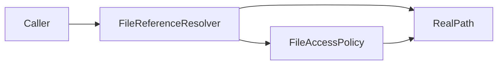

## Files

### Overview

The Files subsystem decides which local files the tables of a configuration file may read and write, and reads the
files it allows. It exists so that the rules for files named by a configuration file, which may come from an
untrusted source, are implemented, tested and reviewed in one place. It is adapted from the Files subsystem of
CanvasNet (the referenced-file engine of its policy model; CanvasNet's obsolete folder sandbox, resolver callback,
search paths, file-count limit, cancellation and custom policies are not part of it).

It contains three units:

- **FileReferenceResolver** - the engine (`FileReferenceResolver`) with its options (`FileReferenceOptions`), result
  (`FileReference`) and failure reporting (`FileReferenceException`, `FileReferenceFailureKind`): validates the path
  text, builds the candidate, opens the file, has the open handle inspected and the policy asked, and reads from the
  same handle; it also checks an output path before anything is written (`CheckOutputPath`) and the text of an input
  pattern before it is listed (`CheckPatternText`), the two parts added by DictionaryMark; see
  *FileReferenceResolver Design*
- **FileAccessPolicy** - the policy (`FileAccessPolicy`) with its request (`FileAccessRequest`) and decision
  (`FileAccessDecision`) and the built-in policies `AllowAll` (`any`), `UnderRoots` (`roots`), `NoSymlinks`
  (`no-symlinks`) and `Combine`; see *FileAccessPolicy Design*
- **RealPath** - the unit that opens a file per operating system and reports whether an open handle is a regular file
  and what its real path is, the real location of a folder, and the path comparison rules; the only place in
  DictionaryMark that calls the operating system directly (`NativeMethods`); the test seams (`FileOpenHooks`) belong
  to it; see *RealPath Design*

The policy model follows references the way Pandoc does - relative, dot-dot and absolute paths and symbolic links -
and lets the host restrict them with a policy that is asked about the **real path of the opened file**, so a decision
cannot be raced by another process that changes the directory tree. Whatever the policy, the subsystem refuses
network paths (UNC and `//host`), device paths (on Windows also a path with a reserved device name such as `NUL`,
`CON`, `COM1` or `NUL.txt` in any component), alternate data streams and any other colon outside a Windows drive,
control characters, and anything that is not a regular file (a directory, a device, a named pipe, opened without
blocking on Linux and macOS), and it reads at most `MaxFileBytes` (16 MiB by default) of a file.

On Windows, `FileReferenceResolver` also refuses, under every policy, a file whose path as written is local but whose
opened file lies on a network share (a symbolic link to a UNC target); a path the host itself placed on a mapped
network drive or share is not affected. Opening the file is what follows the link, so the open itself may already
contact the share before the check refuses the file; Windows evaluates local-to-remote symbolic links according to
`fsutil behavior set SymlinkEvaluation`. Junctions cannot target a share, and creating a symbolic link needs a
privilege or Developer Mode.

Letter case: a path as written is compared case-insensitively on Windows and macOS only as a pre-filter before the
open. The real path decides: it and each root (or the expected path of `no-symlinks`) are brought to the letter case
stored on disk and compared exactly on every platform, so a sibling folder whose name differs from a root only in
letter case is outside that root on a case-sensitive folder, and a root named in another letter case on a
case-insensitive folder still contains its files. No case sensitivity is detected.

### Interfaces

**FileReferenceResolver**: reads and checks the files one table job names.

- *Type*: In-process .NET internal API
- *Role*: Provider - `DictionaryGenerator` creates one resolver per configuration-file table job
- *Contract*: `new FileReferenceResolver(new FileReferenceOptions { BaseDirectory, FileAccess })`;
  `Resolve(path)` returns the approved bytes as a `FileReference`, or `null` when no file exists;
  `CheckOutputPath(path)` returns when the output may be written; the static `CheckPatternText(pattern)` returns when
  an input pattern may be listed. All throw `FileReferenceException` with a `FileReferenceFailureKind` for every
  refusal.
- *Constraints*: not thread-safe; one instance per job. Nothing is created or written by the subsystem.

**FileAccessPolicy**: the rule of a run.

- *Type*: In-process .NET internal API
- *Role*: Provider - `Context` builds one policy per run from `--file-access` and `--allow-root`
- *Contract*: `FileAccessPolicy.AllowAll`, `FileAccessPolicy.NoSymlinks`, `FileAccessPolicy.UnderRoots(folders)`,
  `FileAccessPolicy.Combine(policies)`; `Name` gives `any`, `roots`, `no-symlinks` or `roots+no-symlinks`.
- *Constraints*: immutable and thread-safe; `UnderRoots` captures the real location of each folder when it is created.

**Operating system**: consumed by the `RealPath` unit only - `kernel32.dll` on Windows, the C library and
`/proc/self/fd` on Linux, and the C library (`proc_pidfdinfo` and `realpath`) on macOS.

### Design

The units collaborate in one direction:

For a read, `FileReferenceResolver` validates the text, builds the candidate against the base directory, lets the
policy refuse a path as written before the open, captures the real location of the folders the policy compares
against, opens the candidate through `RealPath`, asks `RealPath` for the facts of the open handle, asks the policy, and
reads from the handle. The policy's base directory is the host-chosen base directory of the resolver (in DictionaryMark
the configuration file's folder), never a folder the configuration file names. The built-in policies use `RealPath`
to compare paths and to find the real location of a root or anchor folder.

For an output, `CheckOutputPath` applies the same steps in the same order without reading: an existing entry at the
path is opened and inspected on its handle, and for an output that does not exist yet the real path is the real
location of its deepest existing folder followed by the rest of the path; a dangling link on the way up to that folder
is refused. It is not free of races: the write that follows goes by name.

For an input pattern, `CheckPatternText` applies only the text rules and, on Windows, the reserved device-name check,
before the pattern is listed, so a network, device or URL-like pattern is refused without contacting any host or
device. Names under local folders may still be listed
before each match is judged; no content is read until `Resolve` allows it.

The subsystem depends only on the .NET base class library (`System.IO`, `System.Runtime.InteropServices`,
`System.Collections.Generic`) and on the operating-system calls of the `RealPath` unit; it has no runtime NuGet
dependency and no dependency on any other DictionaryMark subsystem. Its callers are `Context` (Cli), which builds the
policy, and `DictionaryGenerator` (Dictionary), which reads table inputs and checks table outputs through it and maps a
denial (`AccessDenied` or `RealPathUnavailable`) to the error `file-access-denied`.
